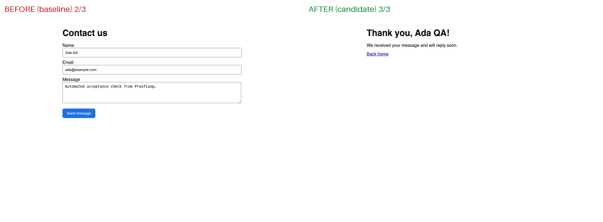

# ProofLoop

**The AI agent that doesn't just find bugs. It proves they're fixed.**

ProofLoop reproduces a broken user journey in a real cloud browser, reads the allowlisted source, asks an LLM for a bounded patch, applies it only to an isolated candidate copy inside a Daytona sandbox, and then re-runs the same browser checks independently. Final pass/fail comes from the browser, not from the model's confidence.

> Scope: this is a hackathon prototype run against **one controlled, intentionally broken demo site** (`fixture_site/`). It is not production ready.

## How it works

```
CLI (python app.py)
  │
  ├─ Daytona sandbox ── baseline copy  (:3000) ── signed preview URL ─┐
  │                  └─ candidate copy (:3001)  ── signed preview URL ─┤
  │                                                                    │
  ├─ Anchor Browser (cloud Chromium over CDP) ◄────────────────────────┘
  │     3 fixed acceptance checks + screenshot
  │
  ├─ LLM diagnose → JSON {root_cause, file_path, find_text, replace_text, reason, confidence}
  ├─ Safety gate  → exact file allowlist, find_text occurs exactly once, size cap,
  │                 no scripts / handlers / external URLs / credentials
  ├─ Patch candidate copy only → fixed sandbox checks (py_compile, Flask routes)
  ├─ Anchor re-verifies candidate preview
  ├─ SurrealDB Agent Memory: recall prior fix outcomes → store verified / failed fixes
  ├─ Arize AX traces: provision · detect · memory · diagnose · patch · test · verify
  └─ artifacts/run_report.json, patch.diff, baseline.png, candidate.png, before_after.png
```

| Step | Tool | What happens |
|---|---|---|
| Provision | **Daytona** Python SDK | One ephemeral sandbox, two separate copies of the site, each served on its own port behind an expiring signed preview URL (1h) |
| Detect | **Anchor Browser** + Playwright over CDP | Cloud browser runs 3 acceptance checks against the baseline preview |
| Diagnose | Claude on **Amazon Bedrock** (or Anthropic / OpenAI API) | Gets failing-check evidence + allowlisted template source + read-only backend; page text is treated as untrusted data |
| Patch | `agent/safety.py` | Proposal is validated, then written to the **candidate** copy only |
| Test | Daytona `process.exec` | Developer-defined commands only (no model-generated shell) |
| Verify | **Anchor Browser** | Same 3 checks, fresh session, against the candidate preview |
| Remember | **SurrealDB Agent Memory** | Recall earlier verified or failed fixes for similar symptoms; store each outcome as a labeled, traceable fact |
| Observe | **Arize AX** (OpenTelemetry / OpenInference) | Span per step with pass counts, root cause, confidence |

## The demo bug

`fixture_site/templates/contact.html` ships with `<button id="send" type="button">`. The backend `POST /contact` works, but clicking **Send message** never submits the form. Nothing in the orchestrator knows this answer; the LLM has to infer it from the browser evidence and the source.

Acceptance checks (`tests/acceptance.py`, fixed by the developer):
1. `homepage_heading`: homepage shows the "Acme Studio" heading
2. `contact_page_reachable`: clicking "Contact us" opens the form
3. `contact_submit_thank_you`: filling the form and clicking Send shows "Thank you"

## Results

Three consecutive full runs on 2026-10-16, both with **Anchor Browser** (cloud) + **Daytona** sandbox + **Claude Sonnet 5.5 on Amazon Bedrock**:

| Run | Baseline | Candidate | Patch attempts | Verified | Baseline copy modified | Total runtime |
|---|---|---|---|---|---|---|
| 1 | 2/3 | 3/3 | 1/2 | yes | no | 34.2 s |
| 2 | 2/3 | 3/3 | 1/2 | yes | no | 41.9 s |
| 3 | 2/3 | 3/3 | 1/2 | yes | no | 38.6 s |

Step timings for run 2 (ms): provision 7492 · detect 12927 · diagnose 3131 · patch 783 · sandbox tests 1352 · verify 13422.

Model's diagnosis (run 1, verbatim): *"The Send button in contact.html is declared with type="button", so clicking it does not submit the form. The page stays on /contact and the POST handler that renders the 'Thank you' page is never reached."* (confidence 0.97)

Patch it proposed, validated by the safety gate and applied only to the candidate copy:

```diff
-    <button id="send" type="button">Send message</button>
+    <button id="send" type="submit">Send message</button>
```



Arize AX received one trace per run (project `proofloop`), with per-step spans and Bedrock LLM token counts.


### Multi-scenario suite (`python app.py --scenario all`)

Three different injected bugs, each in a fresh Daytona sandbox, verified by Anchor. The diagnosing model only sees the resulting site files, never the scenario definitions in `agent/scenarios.py`.

| Scenario | Injected bug | Failing check | Model's fix | Baseline | Candidate | Attempts | Runtime |
|---|---|---|---|---|---|---|---|
| contact-button | Send button is `type="button"` | contact_submit_thank_you | `type="button"` → `type="submit"` | 2/3 | 3/3 | 1 | 34.0 s |
| broken-nav-link | Homepage link points to `/contact-us` (404) | contact_page_reachable | `href="/contact-us"` → `href="/contact"` | 2/3 | 3/3 | 1 | 34.1 s |
| wrong-form-action | Form posts to `/send-message` (404) | contact_submit_thank_you | `action="/send-message"` → `action="/contact"` | 2/3 | 3/3 | 1 | 29.0 s |

**Suite result: 3/3 scenarios verified fixed**, each on the first attempt, with the baseline copy unmodified. Per-scenario reports, diffs and screenshots: `artifacts/suite/<scenario>/`; summary: `artifacts/suite/suite_summary.json`.

### SurrealDB Agent Memory (verified fixes that persist across runs)

Before diagnosing, ProofLoop recalls earlier outcomes for similar symptoms from **SurrealDB Agent Memory**. After verification, it stores the outcome as a labeled fact (`app=proofloop`, `kind=verified_fix|failed_fix`, `scenario=…`, `check=…`, `run=…`). Failed or rejected edits are stored as "do not repeat" facts, and a verified fix is stored as superseding earlier failed attempts for the same symptom. Every recalled hit carries its source and run id, so a hint can be traced to the run that produced it.

Memory is a hint, never an authority. Recalled text goes to the model inside `<memory_hints>` as untrusted data. Every proposal still passes the safety gate, and only the browser decides pass/fail.

Measured on 2026-10-16 (real runs):
- **Suite pass 1** (empty memory): 0 → 1 → 3 hits recalled as the suite progressed; 3/3 fixes verified and stored. On `broken-nav-link` the model correctly ignored a non-matching hint: *"The memory hint concerns a different bug (button type)…"*
- **Pass 2** (`contact-button` again): 5 hits recalled. The top hit (score 0.38) was the earlier verified fix for the same symptom (`page_path_at_failure=/contact`), traceable to run `20261016-142901-010fc5`. Fix verified 3/3 again. Recall took 2.9 s and the write took 7.3 s.

These are results for 3 acceptance checks × 3 scenarios on one demo site, not an accuracy benchmark. Full record: `artifacts/run_report.json`.


## Safety controls

- Patch may touch only `fixture_site/templates/{index,contact,success}.html` (exact allowlist).
- `find_text` must occur exactly once; edits capped at 300 chars; scripts, event handlers, external URLs and credential-like strings are rejected.
- Maximum 2 patch attempts. A failed attempt resets the candidate to baseline before retrying.
- The model never produces shell commands; the sandbox only runs fixed commands from `agent/repair.py`.
- Baseline and candidate are separate copies; the run report records `baseline_copy_modified` (checked after every run).
- Preview URLs are signed and expire; tokens are redacted from logs and the report. The sandbox is deleted after the run.
- No auto-merge, no push, no deploy: a verified patch ends in status `verified_awaiting_human_approval`.
- `tests/test_safety.py`: 16 unit tests for the gate.

## Run it

```bash
pip install -r requirements.txt
python -m playwright install chromium
cp .env.example .env    # fill DAYTONA_API_KEY, ANCHOR_API_KEY, LLM credentials (AWS Bedrock, Anthropic or OpenAI), optional ARIZE_* and SURREAL_MEMORY_*
python -m pytest -q tests/test_safety.py
python app.py                   # full loop on the default bug; --keep-sandbox keeps previews up
python app.py --scenario all    # 3 injected-bug scenarios, each in a fresh sandbox
```

Local-only fixture check (no keys needed):

```bash
PORT=3000 python fixture_site/app.py &
python -m tests.acceptance http://127.0.0.1:3000   # expect 2/3
```

Without `ANCHOR_API_KEY` the browser step falls back to local Playwright, and the report's `browser_provider` says so.

## Limitations

- Three controlled single-bug scenarios on one demo site; pass counts are test-case results, not accuracy claims.
- Text-only evidence to the LLM (screenshot is saved but not sent to the model).
- Single-file, find/replace edits only.

## Next steps

CI integration (run on every preview deploy), multi-file patches with a review UI, and memory shared across teams' sites.
